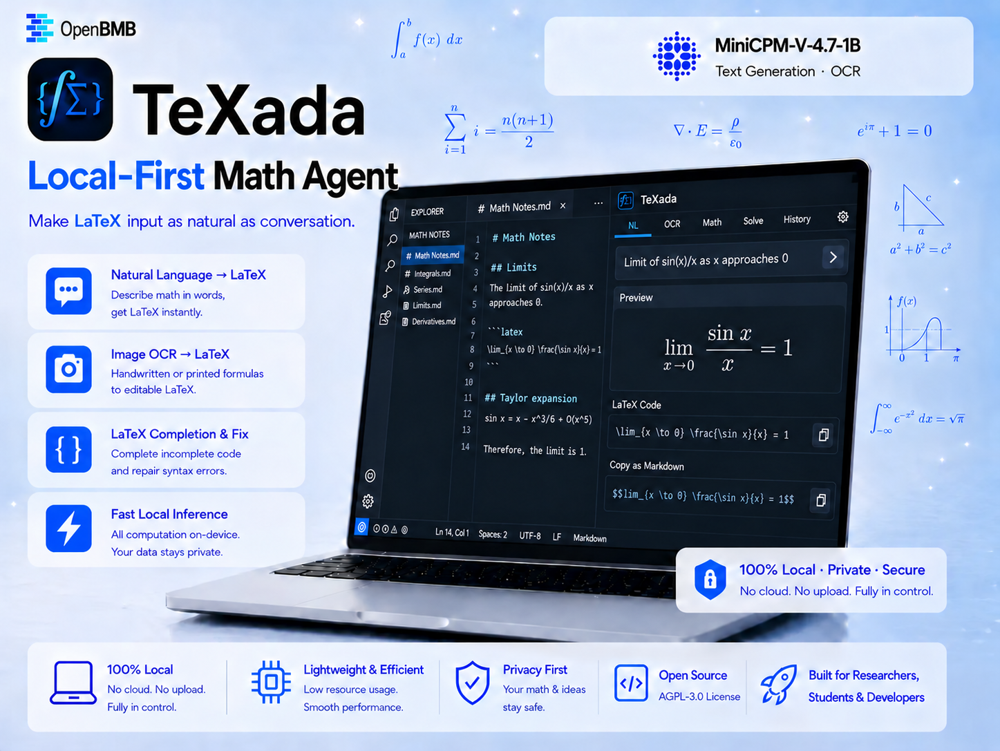
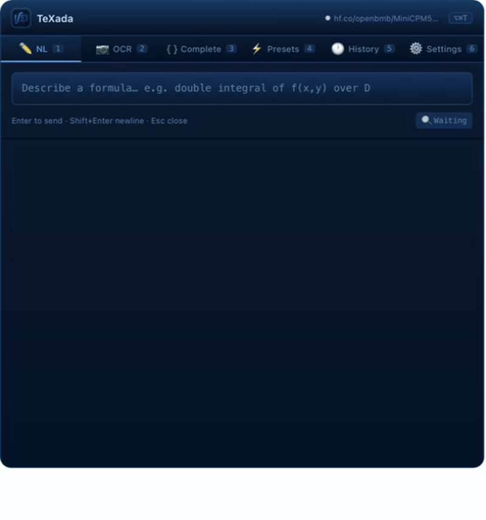

# TeXada

<p align="center">
  <a href="#english">English</a>
  ·
  <a href="#中文">中文</a>
</p>

<p align="center">
  <a href="https://github.com/CacinieP/TeXada-the-Math-Agent/releases"></a>
  <a href="https://github.com/CacinieP/TeXada-the-Math-Agent/actions/workflows/audit.yml"></a>
  <a href="LICENSE"></a>
</p>

<a id="english"></a>

<details open>
<summary><strong>English</strong></summary>



<p align="center">
  <strong>Your local AI copilot for LaTeX and structured mathematical writing.</strong><br>
  Generate formulas, read handwritten math, repair broken TeX, and validate the result before it renders.
</p>



<p align="center">
  Natural language → structured LaTeX · Image → formula · Broken TeX → valid TeX · Local by default
</p>

## TeXada

TeXada is a local AI copilot for LaTeX and scientific writing. Write math in
natural language, paste a screenshot or handwritten formula, or give it an
incomplete TeX expression. TeXada turns the input into a structured formula,
checks it with deterministic tools, and renders a result you can inspect and
copy.

It is not a chat wrapper. TeXada is an on-device, agent-driven structured math
editor whose planner can call narrow, independently testable TeX tools.
It has two model roles: planning/text generation and image understanding/OCR.
The MiniCPM-V 4.7 profile uses one `MiniCPM-V-4.7-1B` checkpoint for both roles;
the existing Ollama defaults use MiniCPM5-2B and MiniCPM-V 4.6.
Independently testable TeX tools own parsing, validation, deterministic
repair, semantic diffing, rendering and export.

**Not a chatbot. A tool-using math agent.**

```text
Planner → TeX Tool → Observation → Planner
                       |
                       v
                 Semantic Unit
```

The Planner does not repair invalid formulas itself. `repair_tex` is a
deterministic local syntax tool, not a third model. See
[Architecture](docs/architecture.md), [Design Evolution](docs/design-evolution.md),
and [Local E2E](docs/e2e-manual.md).

The original `SymbolEngine` and Operator-Drift Guard remain Level 0: they pin
critical operators with near-zero overhead. A pinned KaTeX AST bridge and
role-aware weighted Semantic Diff form Level 1 when an explicit before/after
formula exists. Raw natural language is never treated as a reference AST.

### Highlights

| Capability | Description |
|------------|-------------|
| Natural language to LaTeX | Describe a formula and get copyable LaTeX or Markdown |
| Formula OCR | The vision role proposes a formula; the shared Planner reviews it through TeX tools |
| Completion | Rules or the configured model propose a completion; the shared Agent validates it |
| Validation and repair | Check, fix, render and highlight LaTeX |
| Presets, history, and run logs | Keep reusable presets, reopen results, and inspect each Agent/OCR/completion success or failure with model, latency, tools, and trace |
| Desktop insertion | Click a formula block to type it at the system cursor |
| UI controls | Switch language, zoom from 80% to 140%, and drag the floating window |
| Release packages | macOS DMGs and Windows x64 NSIS installers from GitHub Actions |

### Examples

| Workflow | Demo | What is verified |
|----------|------|------------------|
| Natural language | [Probability density function](examples/01-natural-language/README.md) | Structured LaTeX is compiled and rendered |
| Formula OCR | [Handwritten definite integral](examples/02-image-ocr/README.md) | MiniCPM-V output is reviewed by the shared Agent runtime |
| LaTeX repair | [Incomplete Gaussian PDF](examples/03-latex-repair/README.md) | Missing closing groups are repaired, recompiled, and rendered |

See [all recorded examples](examples/README.md), [Why TeXada?](docs/comparison.md),
and [the design philosophy](docs/design-philosophy.md).

### TeXada Series

| Tool | Workflow | Source |
|------|----------|--------|
| Math Agent | Natural language, formula OCR and completion → checked LaTeX candidates | This repository |
| Studio | Formula syntax and simple table checks in one `.tex` file → candidate Diff → human adoption | [TeXada Studio](https://github.com/CacinieP/TeXada-Studio-with-agentskills) |

Both tools offer a `MiniCPM-V-4.7-1B` profile. Math Agent shares one checkpoint
between text and vision; Studio proposes formula text repairs and retains its
deterministic checkers. The current handoff is copying reviewed LaTeX into Studio.
See [the series workflow and poster](docs/texada-series.md) and
[the MiniCPM-V 4.7 setup and evidence](docs/minicpm-v47.md).
The current API profile is experimental; local Q4 requires separate validation.
The cover illustrates the workflow and is not a screenshot of the desktop app.

### Agent Technical Highlights

| Layer | Technical highlight |
|-------|---------------------|
| Native tool planning | Accepts normalized OpenAI `tool_calls` and legacy MiniCPM5 XML without inventing a separate Agent protocol |
| Six specialist tools | `parse_tex`, `compile_tex`, deterministic `repair_tex`, `semantic_diff`, `render_math`, and `export` have narrow schemas and independent tests |
| Semantic state | Pinned KaTeX 0.17.0 runs in reusable in-process V8 and is normalized into fractions, roots, integrals, scripts, matrix rows/cells, and other Semantic Units |
| Two-level guard | Level 0 preserves critical operators and integral rank; Level 1 compares explicit before/after formulas with role-aware weighted structural Diff |
| Bounded execution | Step limits, repeated-call fingerprints, consecutive-error cutoffs, operator-drift retry limits, request timeouts, and final compile/render guards prevent small-model loops |
| Deterministic acceleration | High-confidence NL and common completion prefixes take a zero-token path while still producing real compile/render observations |
| Unified inputs | NL, MiniCPM-V OCR candidates, and completion candidates share one runtime, trace format, stop reasons, and result contract |
| Observable local runs | A request ledger records run ID, models, latency, tokens, tools, stop reason, formula validity, errors, and expandable Agent trace |

TeXada deliberately does not embed a TeX2TeX repair model. Formula repair is a
deterministic specialist tool, while experimental repair models can evolve in a
separate research repository without coupling product runtime or release size.

The Ollama port is configurable. The default is `http://localhost:11434`, but Settings, `~/.texada/config.json`, and `TEXADA_OLLAMA_HOST` can point TeXada at any host or port.

### Download

For the built-in llama-server setup below, install
[v0.4.2-beta.4 (prerelease)](https://github.com/CacinieP/TeXada-the-Math-Agent/releases/tag/v0.4.2-beta.4).
Choose [TeXada_0.4.2-beta.4_aarch64.dmg](https://github.com/CacinieP/TeXada-the-Math-Agent/releases/download/v0.4.2-beta.4/TeXada_0.4.2-beta.4_aarch64.dmg) for Apple Silicon,
[TeXada_0.4.2-beta.4_x64.dmg](https://github.com/CacinieP/TeXada-the-Math-Agent/releases/download/v0.4.2-beta.4/TeXada_0.4.2-beta.4_x64.dmg) for Intel Macs, or
[TeXada_0.4.2-beta.4_x64-setup.exe](https://github.com/CacinieP/TeXada-the-Math-Agent/releases/download/v0.4.2-beta.4/TeXada_0.4.2-beta.4_x64-setup.exe) for Windows. macOS requires 13.3 or later.
This is a prerelease. Historical beta evaluation still includes 24 mathematically incorrect committed formulas, with Codex judgments and no independent human review. This release provides no new mathematical accuracy validation; compilation, rendering, or submission success does not establish mathematical correctness.

Model weights download separately after installation. The older stable release
is listed below; it does not include the beta's built-in runtime.

The `v0.4.1` desktop release is licensed
`AGPL-3.0-or-later`. Tagged releases retain the license recorded in their
immutable tag: earlier `v0.3.6` artifacts are `GPL-3.0-or-later`, while
`v0.3.7` and later are `AGPL-3.0-or-later`. Current `main` development is
version `0.4.2-beta.4`.

| Platform | Package |
|----------|---------|
| macOS Apple Silicon | `TeXada_0.4.1_aarch64.dmg` |
| macOS Intel | `TeXada_0.4.1_x64.dmg` |
| Windows x64 | `TeXada_0.4.1_x64-setup.exe` |

Release page: [github.com/CacinieP/TeXada-the-Math-Agent/releases](https://github.com/CacinieP/TeXada-the-Math-Agent/releases)

### From A Fresh Machine To First Formula

TeXada release packages are built for end users. You do not need Python, Node.js, Rust, a source checkout, or a separate FastAPI server.

1. Download the package for your machine from the release page.
   - Apple Silicon Macs use the `aarch64.dmg`.
   - Intel Macs use the `x64.dmg`.
   - Windows PCs use the `x64-setup.exe`.

2. Install and open TeXada.
   - macOS: open the DMG and drag TeXada into Applications.
   - Windows: run the setup EXE and start TeXada from the Start menu.

3. Choose one local backend in **Settings → Backend** and click **Save**:
   - **New to TeXada? Choose `Built-in llama-server`** (beta.3 default). Follow [the built-in setup](#quick-start-with-built-in-llama-server): download the model in the app, then click Start. No Ollama installation or API key is needed.
   - **Already using Ollama? Choose `Local Ollama`.** Follow [the Ollama setup](#quick-start-with-ollama): start Ollama, pull the models, and save their names in TeXada.
   - Switching the dropdown alone does not download models. Existing installations keep their saved backend; choose explicitly when switching.
   - A hosted endpoint remains available under `OpenAI-compatible`; see [Cloud Mode](#cloud-mode).

4. Generate the first formula.
   - Open the `NL` tab.
   - Type `integral of x squared from 0 to 1`.
   - Press `Enter` to run the conversion.
   - Use the copy button, or place the cursor in another app and click the formula block to type it there.

5. Try OCR after the vision model is ready.
   - Paste or drop a screenshot into the OCR tab.
   - With llama-server, wait for both the model weights and vision projector to finish downloading. With Ollama, configure the shared 4.7 model in both role fields and verify image inference support.
   - OCR candidates require review before adoption; compilation and rendering do not establish mathematical correctness.

6. Reuse previous work from History.
   - Open the `History` tab to search saved natural-language, completion, OCR, and LaTeX results.
   - Use the type filter to focus on `Natural`, `Complete`, or `OCR` records.
   - Click `Reuse input` to send a saved natural-language or completion prompt back to the matching tab for editing and rerun.
   - Switch to `Run logs` to filter request-level records and expand execution details.

### Choose A Local Backend

| Choice in Settings | Best fit | Model setup | Default address |
|--------------------|----------|-------------|-----------------|
| `Built-in llama-server` | First-time users of beta.3 | Download in TeXada; one `MiniCPM-V-4.7-1B` Q4_K_M checkpoint handles text and OCR, with an F16 vision projector | `http://127.0.0.1:8080` |
| `Local Ollama` | Users who already manage models with Ollama | Pull 4.7 1B once; set both text and OCR fields to its local alias (requires a compatible engine) | `http://localhost:11434` |

Both options run model inference locally. Pick one; you do not need to install
both runtimes. Initial model downloads require an internet connection.

The beta.3 Settings screen shows only the selected backend. Text
and OCR remain separate roles; the built-in runtime currently displays the same
4.7 model for both. Runtime paths, port and timeouts are under **Advanced settings**.
Save after changing the backend or its runtime paths before using service controls.

### Quick Start With Built-in llama-server

1. Install and open **v0.4.2-beta.4** from the release link above.
2. Open **Settings → Backend**, select **`Built-in llama-server`**, and click **Save**.
   Keep the default address `http://127.0.0.1:8080`. Leave **llama-server executable** and **Model directory** blank to use the packaged runtime and `~/.texada/models`.
3. In **Local inference service (llama-server)**, click **Download model**. Wait until downloading finishes for both the model weights and the vision projector. They are not included in the installer.
4. Click **Start** in the same section. Wait for the service to be ready, then return to **NL** and try `x plus y`.
5. To try OCR, open **OCR** and paste or drop a formula image. The same 4.7 model handles text and OCR; review the candidate before adopting it.

You do not need terminal commands, an Ollama model name, or an API key for this
route. If model files are missing, complete **Download model** first. If the
service cannot start, check its status message; port `8080` may already be in
use. Change the llama-server address to a free local port, save, then retry Start.

### Quick Start With Ollama

**Local test status (2026-10-15, Mac mini M4 / 16GB):** Ollama **0.40.3 and 0.40.4** both failed to load the 4.7 1B projector (`unknown projector type: minicpmv4_7`) for text and image inference. Use **Built-in llama-server** on this tested setup. The steps below describe model preparation, not a passed Ollama acceptance test. See the [local test record and evidence summary](docs/local-model-benchmark-2026-10-15.md).

1. Install or update [Ollama](https://ollama.com/download) and open it. If you use the CLI without a running service, run `ollama serve` in a separate terminal.
2. Download the official **MiniCPM-V 4.7 1B** model, then create a descriptive local alias for TeXada's 4.7 profile:

```bash
ollama pull openbmb/minicpm-v4.7:1b
ollama cp openbmb/minicpm-v4.7:1b minicpm-v4.7-1b
```

The [official registry model](https://ollama.com/openbmb/minicpm-v4.7) contains Q4_K_M weights and the vision projector. The alias reuses the downloaded files. Use the explicit `:1b` tag; do not substitute an unqualified tag that may select a larger model.

3. Check that your Ollama engine can load the model:

```bash
ollama run minicpm-v4.7-1b "Reply only: OK"
```

**Runtime compatibility:** the [official 4.7 Ollama guide](https://opensqz.github.io/MiniCPM-V-CookBook/site/en/v4.7/deployment/ollama.html) notes that the bundled inference engine must support the new 4.7 GGUF/projector format. A successful pull does not establish inference or OCR support. If loading fails with `unknown projector type: minicpmv4_7` or a CLIP/projector error, use **Built-in llama-server** while waiting for a compatible Ollama release. A later [local TeXada validation on 2026-10-16](docs/ollama-b11669-validation.md) exercised an Ollama source build pinned to b11669 with 100 NL inputs and 8 synthetic OCR fixtures, and identified the Ollama-specific thinking control fixed below. This does not establish support in older installed releases, real-image accuracy, or mathematical correctness.

4. In TeXada, open **Settings → Backend**, choose **`Local Ollama`**, fill in both model fields, then click **Save**:

| Field | Value |
|-------|-------|
| Ollama address | `http://localhost:11434` |
| Local text model | `minicpm-v4.7-1b` |
| Local vision model | `minicpm-v4.7-1b` |

Do not add `/v1` to the Ollama address. Text generation, planning, completion and OCR use the same model here; the two fields remain independently configurable. The descriptive alias ensures beta.3 recognizes the 4.7 1B profile. Existing installations retain their saved names, so set **both** fields explicitly.

5. Return to **NL** and try `x plus y`, then test a formula image in **OCR** and review the result. If disconnected, check that Ollama is running. For missing models, compare both Settings names with `ollama list`. Model presence, successful text output, and successful rendering do not establish OCR or mathematical correctness.

### macOS Local Model Notes

- **Apple Silicon:** run the native Ollama app or CLI to use automatic Metal
  GPU acceleration. Running Ollama inside a Docker Desktop container on macOS
  does not provide GPU acceleration; see the [Ollama FAQ](https://docs.ollama.com/faq#how-do-i-use-ollama-with-gpu-acceleration-in-docker).
- **Historical 8GB measurement (not a 4.7 result):** local text inference was validated on an A18 Pro Mac with
  8GB unified memory using MiniCPM5-2B Q4_K_M and a 4096-token context. Ollama
  reported about 1.66 GiB of model residency; the app, macOS and other programs
  need additional memory. See the [local measurements](docs/local-model-benchmark-2026-09-12.md)
  for the tested configuration and scope; OCR memory requirements were not tested.
- **Intel Macs:** use the Intel installer. Local model performance has not been
  measured on Intel Macs; the Apple Silicon acceleration and timing results
  documented here do not establish Intel performance.

### Connection Map And Ports

TeXada uses two local HTTP layers. They should normally use different ports:

```text
Desktop UI -> TeXada FastAPI API -> llama-server, Ollama, or a hosted model endpoint
```

| Layer | Default | What it is for |
|-------|---------|----------------|
| TeXada FastAPI API | `http://127.0.0.1:18732` | Bundled with the installer and auto-started by the desktop app |
| Built-in llama-server | `http://127.0.0.1:8080` | Model service controlled by Download model / Start / Stop in Settings |
| Ollama model endpoint | `http://localhost:11434` | The FastAPI backend calls local model APIs and adds `/v1` internally |
| Cloud model endpoint | Provider-specific `/v1` base URL | Used only when Backend is `OpenAI-compatible` |

Do not set the FastAPI address and Ollama address to the same port unless you are deliberately running a custom proxy. If Settings shows a network/API error, restart TeXada and check whether `18732` is already occupied. If FastAPI is reachable but status says `Disconnected` or `Model missing`, check the selected runtime and its model files or names.

The following is the current **Ollama setup example**, configured explicitly after the quick start above. Beta.3 retains legacy Ollama defaults (`MiniCPM5-2B` text and `MiniCPM-V 4.6` OCR) and saved settings; it does not migrate them automatically.

| Role | Configured model | Notes |
|------|---------|-------|
| Text | `minicpm-v4.7-1b` | Planning, natural language conversion and completion |
| Vision | `minicpm-v4.7-1b` | OCR from screenshots and images |

The older MiniCPM5-2B Ollama text profile disables thinking to fit its output budget. Its historical local validation used a 4096-token context; those measurements do not validate the 4.7 Ollama configuration above.

These are the only two supported model roles. OpenAI-compatible configuration
is a transport option for serving the same MiniCPM models through vLLM, SGLang,
or another compatible endpoint; it does not add a third product model.

Ollama does not have to run on port `11434`. In Settings → Backend → Ollama address, use any reachable endpoint:

```text
http://localhost:11435
http://192.168.1.20:11434
```

Do not add `/v1`; TeXada adds the OpenAI-compatible suffix internally.
For local loopback endpoints, TeXada can try to start `ollama serve` if the Ollama CLI is installed. Remote Ollama endpoints must already be running and reachable.

### Cloud Mode

**MiniCPM-V 4.7 single-model profile:** use the official
[1B checkpoint](https://huggingface.co/openbmb/MiniCPM-V-4.7-1B) through
`https://api.modelbest.cn/v1`, with `MiniCPM-V-4.7-1B` as both the text and
vision model. Export `TEXADA_OPENAI_API_KEY`, then run
`bash scripts/run-minicpm-v47.sh`. The adapter disables thinking for all
four inference paths and their retries. The same profile can connect to an
external llama-server using the official
[Q4 GGUF](https://huggingface.co/openbmb/MiniCPM-V-4.7-1B-gguf).
See [setup, evidence and limits](docs/minicpm-v47.md) and
[ADR-017](docs/adr/017-minicpm-v47-single-checkpoint.md).

OpenAI-compatible models can be configured from Settings. **Text and OCR each
have their own service address, API key and model name.** OCR requests and their
retries use the OCR connection; planning and text generation use the text connection.
Existing shared-service configurations still work: an empty OCR address uses the
text address. A different OCR address requires its own key and model name; text
credentials are never automatically sent to that different service. For cloud providers, enter the complete Chat Completions base URL expected by that provider; TeXada does not append `/v1` to cloud endpoints. Example:

```json
{
  "backend": "openai_compatible",
  "openai_base_url": "https://your-provider.example/v1",
  "openai_vision_base_url": "https://your-ocr-provider.example/v1",
  "openai_model_name": "your-text-model",
  "openai_vision_model_name": "your-vision-model",
  "openai_api_key": "your-text-api-key",
  "openai_vision_api_key": "your-ocr-api-key"
}
```

StepFun Step Plan example:

```json
{
  "backend": "openai_compatible",
  "openai_base_url": "https://api.stepfun.com/step_plan/v1",
  "openai_model_name": "step-3.7-flash",
  "openai_vision_model_name": "step-3.7-flash",
  "openai_api_key": "your-api-key"
}
```

The StepFun Step Plan OpenAI-compatible Chat Completions base URL is `https://api.stepfun.com/step_plan/v1`, and `step-3.7-flash` is the recommended validation model in StepFun's public documentation.

### Configuration

Persistent config lives at `~/.texada/config.json`. Most users can use Settings instead.
The following is an **Ollama example**, not the default backend for a fresh beta.3 install.

```json
{
  "backend": "ollama",
  "ollama_host": "http://localhost:11434",
  "model_name": "minicpm-v4.7-1b",
  "vision_model_name": "minicpm-v4.7-1b",
  "api_host": "127.0.0.1",
  "api_port": 18732,
  "ui_language": "zh",
  "ui_zoom": 1.0,
  "max_tokens": 2048,
  "run_log_max_days": 0,
  "run_log_max_items": 0
}
```

| Variable | Purpose |
|----------|---------|
| `TEXADA_BACKEND` | `llama_server` (default), `ollama`, or `openai_compatible` |
| `TEXADA_LLAMA_SERVER_HOST` | Built-in model service address; default `http://127.0.0.1:8080` |
| `TEXADA_LLAMA_SERVER_BINARY`, `TEXADA_LLAMA_MODELS_DIR` | Optional runtime executable and model directory overrides |
| `TEXADA_OLLAMA_HOST` | Local Ollama base URL, including custom ports |
| `TEXADA_MODEL_NAME`, `TEXADA_VISION_MODEL_NAME` | Local text and vision model names |
| `TEXADA_OPENAI_BASE_URL` | Full OpenAI-compatible cloud base URL |
| `TEXADA_OPENAI_MODEL_NAME`, `TEXADA_OPENAI_VISION_MODEL_NAME` | Cloud text and vision model names |
| `TEXADA_OPENAI_API_KEY` | Text service API key |
| `TEXADA_OPENAI_VISION_BASE_URL`, `TEXADA_OPENAI_VISION_API_KEY` | Independent OCR service address and API key |
| `TEXADA_API_HOST`, `TEXADA_API_PORT` | FastAPI bind address |
| `TEXADA_API_BASE` | Explicit desktop shell API base |
| `TEXADA_DISABLE_BUNDLED_BACKEND` | Set to `1` only when you want to manage the FastAPI backend yourself |
| `TEXADA_API_TIMEOUT_SECS` | Desktop API request timeout |
| `TEXADA_INFERENCE_TIMEOUT_SECONDS`, `TEXADA_API_REQUEST_TIMEOUT_SECONDS` | Backend model and HTTP timeouts |
| `TEXADA_AGENT_MAX_STEPS` | Maximum MiniCPM5 planner/tool turns |
| `TEXADA_UI_LANGUAGE`, `TEXADA_UI_ZOOM` | UI language (`zh` or `en`) and zoom (`0.8` to `1.4`) |

### Data Backup

TeXada can export and import local data from Settings → Data.

Exports are JSON files and can include conversion history, request-level run
logs, user-defined presets, and non-sensitive settings. API keys and OCR image
bytes are never exported. History, logs, and presets can also be exported or
imported independently. Imports merge by default and skip duplicates.

See [docs/data-backup.md](docs/data-backup.md) for the JSON format.

### Privacy And Limits

| Topic | Behavior |
|-------|----------|
| Built-in llama-server | Model requests stay on the configured local llama-server endpoint |
| Local Ollama mode | Model requests stay on the configured Ollama endpoint |
| Cloud mode | Text and images are sent to the configured provider endpoint |
| API keys | Saved in `~/.texada/config.json`; do not paste keys into public issues |
| OCR uploads | Accepts PNG, JPEG, WebP, BMP and TIFF up to 5 MB |
| Math correctness | Always review generated formulas before using them in final work |

### Troubleshooting

| Symptom | Check |
|---------|-------|
| Settings shows API/network error | Restart TeXada; if it persists, check whether another process already uses `127.0.0.1:18732` |
| Status is `Disconnected` | Check the selected backend: Start llama-server in Settings, or open Ollama; verify its host/port |
| llama-server reports missing models | Click Download model and wait for both weights and projector to finish |
| Status is `Model missing` | Pull the text model shown in the status tooltip |
| Status is `Text ready · OCR missing` | Pull the vision model shown in the status tooltip |
| Cloud mode returns 401/403 | API key, provider base URL, and model name |
| Clicking a formula copies instead of inserting | Browser mode falls back to copy; desktop insertion also needs OS paste automation permission |

### Experimental CAS Boundary

Version 0.3.2 includes an optional developer-facing CAS scaffold and a
reproducible capability matrix. It is not connected to the Agent, API, or
desktop UI, and the six public TeX tools remain unchanged. TeXada therefore
does not claim to prove arbitrary formula correctness in this release.

The production-direction adapter starts from TeXada Semantic Units and accepts
only a declared scalar subset. Raw ANTLR/Lark LaTeX parsing exists only in the
evaluation probes. Unsupported notation is rejected, `.equals() == False`
never becomes a contradiction by itself, and every positive result records its
assumptions and evidence path.

Source contributors can run the pinned gate with:

```bash
uv run --extra dev --extra cas-eval pytest \
  tests/test_cas_translator.py \
  tests/test_cas_checker.py \
  tests/test_cas_capabilities.py
```

See [the SymPy capability matrix](docs/sympy-capability-matrix.md) for the
supported boundary, known parser drift, seed policy, and acceptance red lines.

### Release CI

GitHub Actions builds release installers manually from `main` and automatically from version tags.

| Workflow | Checks |
|----------|--------|
| `Audit` | Ruff, pytest, pip-audit, npm audit, JS syntax check, Tauri cargo check on macOS and Windows |
| `Desktop Release` | Pre-release audit, PyInstaller FastAPI sidecar, signed and notarized macOS arm64/Intel DMG, Windows x64 NSIS installer, official release publishing |

### Shortcuts

| Action | Shortcut |
|--------|----------|
| Show or hide popup | macOS `Option+Command+T`, Windows `Ctrl+Alt+T` |
| Toggle render mode | macOS `Command+K`, Windows `Ctrl+K` |
| Zoom in | `Command/Ctrl + +` |
| Zoom out | `Command/Ctrl + -` |
| Reset zoom | `Command/Ctrl + 0` |
| Move window | drag the header or empty panel space |

### Hardware And Measurements

Validated on 2026-09-12 with Apple A18 Pro, 8GB unified memory, macOS
26.6.2 and Ollama 0.32.15. MiniCPM5-2B Q4_K_M ran on Metal with a 4096-token
context; Ollama reported about **1.66 GiB of model residency**, not total
application/system memory.

| Six development regression cases | Mean request time | Strict structure match | Compile/render commit |
|---------------------------------|-------------------|------------------------|-----------------------|
| Previous 1B path, default thinking | 38.59s | 1/6 | 3/6 |
| 1B control, thinking disabled | 13.39s | 1/6 | 5/6 |
| Adapted 2B path, thinking disabled | **7.71s** | **5/6** | **6/6** |

Manual review found all six final 2B formulas mathematically faithful; the
strict mismatch was extra condition-label text in a piecewise expression.
These are small, repair-driven development samples, not a held-out accuracy
benchmark or an isolated comparison of model speed. Warm state, thinking
settings and code fixes affect the results. Complex formulas can still be
wrong. See the [test setup, individual cases and limitations](docs/local-model-benchmark-2026-09-12.md).

#### Historical 1B Measurements

The numbers below are historical local measurements from 2026-07-07 using MiniCPM5-1B for text. They do not measure the current MiniCPM5-2B default. Latency depends on model size, quantization, machine load and whether the model is warm.

Measured environment: Mac Neo, macOS 26.5.1, arm64, Apple A18 Pro, 8GB RAM, local Ollama models.

| Scenario | Recommended hardware |
|----------|----------------------|
| Text conversion and completion | Apple Silicon, Intel i5/Ryzen 5 or better, 8GB RAM |
| Regular screenshot OCR | Apple Silicon M2/M3 class or better, 16GB RAM |
| Heavy OCR or larger models | 16GB+ RAM, discrete GPU, or a cloud vision model |

| Operation | Model | Observed latency |
|-----------|-------|------------------|
| NL to LaTeX, cold | MiniCPM5-1B | 179204.3ms |
| NL to LaTeX, warm | MiniCPM5-1B | 29612.2ms |
| LaTeX completion | MiniCPM5-1B plus rules | 1808.5ms |
| OCR sample | MiniCPM-V 4.6 | 39419.0ms |

### Local Evaluation

First quantitative baseline, measured 2026-09-19 against a live local
llama-server running MiniCPM5-2B Q4_K_M:

| Metric | Result |
|--------|--------|
| NL to LaTeX structural pass rate | 28/95 (29.5%) |
| Compile layer | 65/100 |
| Render layer | 98/100 |
| Trace layer | 98/100 |
| Deterministic repair pass rate | 53/53 (brace-balance scope) |
| Latency p50 / p95 | 5.5s / 9.4s |

Development-regression scope; not a general benchmark. The structural rate is
low and honest: it is the baseline every later iteration must improve.
Reproduce with `eval/run_real_baseline.py --mode live`; the CI gate replays
recorded outputs with `--mode recorded`. Details and measured boundaries live
in [eval/known-gaps.md](eval/known-gaps.md) and
[eval/reports/2026-09-19-baseline-live.md](eval/reports/2026-09-19-baseline-live.md).

### Quality Gate

The current `main` branch has no known blocking issue after the latest audit pass. That means tests and static checks pass; it is not a mathematical promise that no software bug can exist. Maintainer validation details live in [Contributing](.github/CONTRIBUTING.md), [Source audit](docs/audit.md), and GitHub Actions.

### Documentation

| Area | Links |
|------|-------|
| Technical docs | [Docs index](docs/README.md), [Architecture](docs/architecture.md), [Technical report](docs/technical-report.md), [Source audit](docs/audit.md), [File inventory](docs/file-inventory.md) |
| Community | [Contributing](.github/CONTRIBUTING.md), [Security](.github/SECURITY.md), [Support](.github/SUPPORT.md), [Code of Conduct](.github/CODE_OF_CONDUCT.md), [Changelog](CHANGELOG.md) |

### License

Current `main` development is licensed under `AGPL-3.0-or-later`; tagged
releases retain the license recorded in their immutable tag. See [LICENSE](LICENSE).

</details>

<a id="中文"></a>

<details>
<summary><strong>中文</strong></summary>


## TeXada

TeXada 是一个面向 LaTeX 与科研写作的本地 AI Copilot。你可以输入自然语言、
粘贴截图或手写公式，也可以交给它一段不完整的 TeX；TeXada 会把输入转换为
结构化公式，用确定性工具检查，再渲染为可核对、可复制的结果。

它不是聊天界面套壳，而是基于端侧 Agent 的结构化数学编辑器。产品明确只有两个
模型保留规划/文本与视觉/OCR 两个职责。MiniCPM-V 4.7 profile 用同一个
`MiniCPM-V-4.7-1B` checkpoint 承担两者；既有 Ollama 默认仍由
MiniCPM5-2B 负责规划、工具选择和文本生成，MiniCPM-V 4.6 负责图片
理解与公式 OCR；解析、校验、确定性修复、语义 Diff、渲染与导出由可独立测试的
TeX 工具负责。

**不是聊天机器人，而是会调用工具的数学 Agent。**

```text
Planner → TeX Tool → Observation → Planner
                       |
                       v
                 Semantic Unit
```

Planner 不直接修复非法公式；`repair_tex` 是确定性本地语法工具，不是第三个
模型。详见[架构文档](docs/architecture.md)与
[设计思路与版本迭代](docs/design-evolution.md)、[本地 E2E 指南](docs/e2e-manual.md)。

原有 `SymbolEngine` 与 Operator-Drift Guard 被保留为 Level 0，以近乎零开销
锁定关键算符；固定版本的 KaTeX AST 桥与角色感知的加权 Semantic Diff 构成
Level 1，但只在明确存在 before/after 公式时启用，不会把自然语言伪装成参考 AST。

### 亮点

| 能力 | 说明 |
|------|------|
| 自然语言转 LaTeX | 输入公式描述，生成可复制的 LaTeX 或 Markdown |
| 公式 OCR | 视觉职责产出候选，共享 Planner 再通过 TeX 工具审查 |
| 公式补全 | 规则或配置的模型产出候选，再由统一 Agent 校验 |
| 校验与修复 | 检查、修复、渲染并高亮 LaTeX |
| 预设、历史与运行日志 | 保存预设、重新打开结果，并检查每次 Agent/OCR/补全成功或失败的模型、耗时、工具与轨迹 |
| 桌面键入 | 点击公式块即可在系统当前光标处键入公式 |
| 界面控制 | 设置页切换中英文、80% 到 140% 缩放、拖动浮窗 |
| 安装包发布 | GitHub Actions 构建 macOS DMG 和 Windows x64 NSIS 安装包 |

### 示例

| 工作流 | 演示 | 实际验证 |
|--------|------|----------|
| 自然语言 | [概率密度函数](examples/01-natural-language/README.md) | 结构化 LaTeX 经过编译与渲染 |
| 公式 OCR | [手写定积分](examples/02-image-ocr/README.md) | MiniCPM-V 候选经过统一 Agent Runtime 审查 |
| LaTeX 修复 | [未闭合的 Gaussian PDF](examples/03-latex-repair/README.md) | 补全缺失分组后重新编译并渲染 |

更多内容见[全部实录示例](examples/README.md)、[为什么选择 TeXada](docs/comparison.md)
和[设计哲学](docs/design-philosophy.md)。

### TeXada 系列

| 工具 | 工作流 | 源码 |
|------|--------|------|
| Math Agent | 自然语言、公式 OCR、补全 → 经过检查的 LaTeX 候选 | 当前仓库 |
| Studio | 单个 `.tex` 的公式语法、简单表格检查 → 候选 Diff → 人工采用 | [TeXada Studio](https://github.com/CacinieP/TeXada-Studio-with-agentskills) |

两个工具均提供 `MiniCPM-V-4.7-1B` profile。Math Agent 用同一个 checkpoint
承担文本与视觉；Studio 生成公式文本修复候选，继续交给确定性检查器回判。
当前交接方式是复制已审阅的 LaTeX 到 Studio。
见[系列工作流与海报](docs/texada-series.md)和[4.7 配置与验收](docs/minicpm-v47.md)。
API profile 处于实验阶段，本机 Q4 需单独验收。封面为工作流示意，不是真实桌面截图。

### Agent 技术亮点

| 层级 | 技术亮点 |
|------|----------|
| 原生工具规划 | 接收标准 OpenAI `tool_calls` 与既有 MiniCPM5 XML，不另造一套 Agent 协议 |
| 六个专家工具 | `parse_tex`、`compile_tex`、确定性 `repair_tex`、`semantic_diff`、`render_math`、`export` 均有窄 schema 和独立测试 |
| 结构化状态 | 固定 KaTeX 0.17.0 在可复用进程内 V8 中运行，并归一化为分式、根式、积分、上下标、矩阵行列等 Semantic Unit |
| 两级守卫 | Level 0 保留关键算符和积分阶数；Level 1 对明确的 before/after 公式执行角色感知加权结构 Diff |
| 有界执行 | 步数上限、重复调用指纹、连续错误截断、算符漂移重试上限、请求超时与最终 compile/render guard 防止小模型循环 |
| 确定性加速 | 高置信度 NL 和常见补全前缀走零 token 路径，但仍生成真实 compile/render Observation |
| 三入口统一 | NL、MiniCPM-V OCR 候选、补全候选共用 Runtime、trace、stop reason 与结果合约 |
| 本地可观察性 | 请求账本记录 run ID、模型、耗时、token、工具、停止原因、公式有效性、错误和可展开 Agent trace |

TeXada 不内置 TeX2TeX 修复模型。公式修复由确定性专家工具负责，实验性修复模型可在
独立研究仓库演进，不与产品 Runtime 和安装包体积耦合。

Ollama 端口不是写死的。默认地址是 `http://localhost:11434`，但可以在设置页、`~/.texada/config.json` 或 `TEXADA_OLLAMA_HOST` 中改为任意主机和端口。

### 下载

使用下方内置 llama-server 路线，请安装
[v0.4.2-beta.4 预发布版](https://github.com/CacinieP/TeXada-the-Math-Agent/releases/tag/v0.4.2-beta.4)。
Apple Silicon Mac 选择 [TeXada_0.4.2-beta.4_aarch64.dmg](https://github.com/CacinieP/TeXada-the-Math-Agent/releases/download/v0.4.2-beta.4/TeXada_0.4.2-beta.4_aarch64.dmg)，
Intel Mac 选择 [TeXada_0.4.2-beta.4_x64.dmg](https://github.com/CacinieP/TeXada-the-Math-Agent/releases/download/v0.4.2-beta.4/TeXada_0.4.2-beta.4_x64.dmg)，
Windows 选择 [TeXada_0.4.2-beta.4_x64-setup.exe](https://github.com/CacinieP/TeXada-the-Math-Agent/releases/download/v0.4.2-beta.4/TeXada_0.4.2-beta.4_x64-setup.exe)。macOS 需要 13.3 或更新版本。
这是预发布版。历史 beta 评测仍有 24 条数学错误公式成功提交，判定来自 Codex，尚无独立人工复核。本版未新增数学准确率验证；编译、渲染或提交成功均不保证数学语义正确。

模型权重在安装后单独下载。下表保留旧稳定版下载信息；旧稳定版不包含 beta 的内置运行时。

`v0.4.1` 桌面版本适用 `AGPL-3.0-or-later`。每个标签及其
安装包继续适用标签内记录的许可证：`v0.3.6` 及更早产物为
`GPL-3.0-or-later`，`v0.3.7` 起为 `AGPL-3.0-or-later`。当前 `main` 开发
版本为 `0.4.2-beta.4`。

| 平台 | 安装包 |
|------|--------|
| macOS Apple Silicon | `TeXada_0.4.1_aarch64.dmg` |
| macOS Intel | `TeXada_0.4.1_x64.dmg` |
| Windows x64 | `TeXada_0.4.1_x64-setup.exe` |

Release 页面：[github.com/CacinieP/TeXada-the-Math-Agent/releases](https://github.com/CacinieP/TeXada-the-Math-Agent/releases)

### 从裸机到第一次使用

TeXada 的 release 安装包面向普通用户。你不需要安装 Python、Node.js、Rust，也不需要拉源码或手动启动 FastAPI 服务。

1. 从 Release 页面下载适合自己机器的安装包。
   - Apple Silicon Mac 选择 `aarch64.dmg`。
   - Intel Mac 选择 `x64.dmg`。
   - Windows 电脑选择 `x64-setup.exe`。

2. 安装并打开 TeXada。
   - macOS：打开 DMG，把 TeXada 拖到 Applications。
   - Windows：运行安装器，然后从开始菜单启动 TeXada。

3. 在**设置 → 后端连接**中选择一种本地后端，然后点击**保存**。
   - **第一次使用，建议选 `Built-in llama-server`**（beta.3 默认值）：按[内置启动步骤](#内置-llama-server-快速启动)，在应用内下载模型并点击启动，无需安装 Ollama 或填写 API key。
   - **已经在用 Ollama，选 `Local Ollama`**：按 [Ollama 启动步骤](#ollama-快速启动)，启动 Ollama、下载模型，并在 TeXada 保存模型名。
   - 只切换下拉框不会自动下载模型。升级安装会保留已有后端设置，需要切换时请明确选择。
   - 远程服务仍可选择 `OpenAI-compatible`，详见[云侧模式](#云侧模式)。

4. 生成第一个公式。
   - 打开 `NL` 页签。
   - 输入 `0 到 1 上 x 平方的积分`。
   - 按 `Enter` 执行转换。
   - 可以点击复制按钮，也可以先把光标放到其他应用里，再点击公式块把公式键入到光标处。

5. 视觉模型准备好后再试 OCR。
   - 在 OCR 页签粘贴或拖入公式截图。
   - llama-server 需要模型权重与视觉投影文件均下载完成；Ollama 路线请在两个角色字段填写同一个 4.7 模型，并确认引擎支持图片推理。
   - OCR 候选需要人工审阅后采用；编译和渲染成功不代表数学含义正确。

6. 从历史页复用旧记录。
   - 打开 `历史` 页签，搜索保存过的自然语言、补全、OCR 和 LaTeX 结果。
   - 使用类型筛选专注查看自然语言、补全或 OCR 记录。
   - 点击 `复用输入` 可以把历史自然语言或补全片段送回对应页签，继续编辑或重新生成。
   - 切换到 `运行日志`，可以筛选请求并展开查看执行详情。

### 选择本地后端

| 设置中的选项 | 适合谁 | 模型准备 | 默认地址 |
|--------------|--------|----------|----------|
| `Built-in llama-server` | 首次使用 beta.3 的用户 | 在 TeXada 内下载；同一个 `MiniCPM-V-4.7-1B` Q4_K_M 模型负责文本和 OCR，配合 F16 视觉投影文件 | `http://127.0.0.1:8080` |
| `Local Ollama` | 已经用 Ollama 管理模型的用户 | 下载一次 4.7 1B；文本和 OCR 都填写其本地别名（需要兼容引擎） | `http://localhost:11434` |

两条路线都在本地执行模型推理，选一条即可，无需同时安装两个运行时。
首次下载模型需要联网。

beta.3 设置页只展示所选后端。文本与 OCR 保留独立角色；内置运行时当前
显示二者共用的 4.7 模型。运行时路径、端口和超时位于**高级设置**。
切换后端或修改运行时路径后，先保存再操作服务按钮。

### 内置 llama-server 快速启动

1. 从上方 Release 链接安装并打开 **v0.4.2-beta.4**。
2. 打开**设置 → 后端连接**，选择 **`Built-in llama-server`**，点击**保存**。
   地址保留 `http://127.0.0.1:8080`；**llama-server 路径**和**模型目录**留空，使用应用内置运行时及 `~/.texada/models`。
3. 在**本地推理服务（llama-server）**中点击**下载模型**，等待模型权重和视觉投影文件全部下载完成。安装包不包含这些文件。
4. 在同一区域点击**启动**，等待服务就绪，回到 **NL** 页签输入 `x 加上 y` 试用。
5. 需要识图时，进入 **OCR** 页签粘贴或拖入公式图片。文本和 OCR 使用同一个 4.7 模型；采用前请审阅候选结果。

这条路线无需终端命令、Ollama 模型名或 API key。
提示缺模型时，先完成**下载模型**；启动失败时查看服务状态信息，确认 `8080` 端口是否被占用。
如有冲突，将 llama-server 地址改为可用的本机端口，保存后再次启动。

### Ollama 快速启动

**本机实测状态（2026-10-15，Mac mini M4 / 16GB）：**Ollama **0.40.3 和 0.40.4** 均无法加载 4.7 1B 视觉投影，文本和图片推理都报 `unknown projector type: minicpmv4_7`。本次环境请使用 **Built-in llama-server**。下方步骤仅说明模型准备方式，不代表 Ollama 已通过验收，详见[本机实测记录与证据摘要](docs/local-model-benchmark-2026-10-15.md)。

1. 安装或更新并打开 [Ollama](https://ollama.com/download)。如果只使用 CLI 且服务未运行，在单独终端执行 `ollama serve`。
2. 下载官方 **MiniCPM-V 4.7 1B**，再创建用于 TeXada 4.7 配置识别的本地别名：

```bash
ollama pull openbmb/minicpm-v4.7:1b
ollama cp openbmb/minicpm-v4.7:1b minicpm-v4.7-1b
```

[官方仓库模型](https://ollama.com/openbmb/minicpm-v4.7)包含 Q4_K_M 权重和视觉投影文件，别名复用已下载文件。请明确使用 `:1b`，不要省略标签而误选更大的模型。

3. 先确认当前 Ollama 引擎可以加载模型：

```bash
ollama run minicpm-v4.7-1b "Reply only: OK"
```

**运行时兼容性：**[官方 4.7 Ollama 指南](https://opensqz.github.io/MiniCPM-V-CookBook/site/en/v4.7/deployment/ollama.html)提醒，Ollama 内置推理引擎需要支持新的 4.7 GGUF 与视觉投影格式。下载成功不等于推理或 OCR 可用。如果出现 `unknown projector type: minicpmv4_7` 或 CLIP/视觉投影加载错误，请先使用 **Built-in llama-server**，等待兼容的 Ollama 版本。本次 README 更新不代表完成新的 TeXada/Ollama 文本或真实图片准确率验证。

4. 在 TeXada 的**设置 → 后端连接**中选择 **`Local Ollama`**，填写两个模型字段并点击**保存**：

| 设置项 | 填写内容 |
|--------|----------|
| Ollama 地址 | `http://localhost:11434` |
| 本地文本模型 | `minicpm-v4.7-1b` |
| 本地视觉模型 | `minicpm-v4.7-1b` |

Ollama 地址不要加 `/v1`。此处文本生成、规划、补全和 OCR 使用同一个模型；两个字段仍可分别配置。上述明确的本地别名可让 beta.3 识别 4.7 1B 配置。升级安装会保留原有名称，请手动修改**两个**字段。

5. 回到 **NL** 输入 `x 加上 y`，再到 **OCR** 测试公式图片并人工核对结果。显示未连接时，先确认 Ollama 已启动；显示模型缺失时，用 `ollama list` 核对两个模型名。模型已安装、文本输出成功和渲染成功均不证明 OCR 或数学语义正确。

### macOS 本地模型使用说明

- **Apple Silicon：**使用原生 Ollama 应用或 CLI，会自动使用 Metal GPU 加速。
  在 macOS 的 Docker Desktop 容器内运行 Ollama 不提供 GPU 加速，详见
  [Ollama 官方说明](https://docs.ollama.com/faq#how-do-i-use-ollama-with-gpu-acceleration-in-docker)。
- **历史 8GB 测量（不是 4.7 的结果）：**已在 A18 Pro、8GB 统一内存的 Mac 上验证 MiniCPM5-2B Q4_K_M
  配合 4096 token 上下文可用于本地文本推理。Ollama 报告模型驻留约 1.66 GiB；
  应用、macOS 和其他程序还需要额外内存。测试配置和范围见
  [本机实测记录](docs/local-model-benchmark-2026-09-12.md)；本次未测试 OCR 的内存需求。
- **Intel Mac：**请使用 Intel 安装包。本项目尚未实测 Intel Mac 的本地模型性能，
  本文记录的 Apple Silicon 加速和耗时数据不能作为 Intel 机型的性能结论。

### 连接层级与端口

TeXada 使用两层本地 HTTP 服务。它们通常应该是不同端口：

```text
桌面 UI -> TeXada FastAPI API -> llama-server、Ollama 或远程模型 endpoint
```

| 层级 | 默认值 | 用途 |
|------|--------|------|
| TeXada FastAPI API | `http://127.0.0.1:18732` | 随安装包内置，由桌面应用自动启动 |
| 内置 llama-server | `http://127.0.0.1:8080` | 在设置中下载模型、启动和停止的推理服务 |
| Ollama 模型 endpoint | `http://localhost:11434` | FastAPI 后端调用本地模型接口，并在内部自动拼接 `/v1` |
| 云侧模型 endpoint | 服务商提供的 `/v1` base URL | 仅在后端选择 `OpenAI-compatible` 时使用 |

除非你主动配置了自定义代理，不要把 FastAPI 地址和 Ollama 地址设成同一个端口。如果设置页显示 API/网络错误，先重启 TeXada，并检查 `18732` 是否已被其他进程占用；如果 FastAPI 可达但状态是 `未连接` 或 `模型缺失`，再检查所选运行时及其模型文件或模型名。

下表是按上述步骤手动设置的 **Ollama 配置示例**。beta.3 仍保留旧 Ollama 默认值（文本 `MiniCPM5-2B`、OCR `MiniCPM-V 4.6`）与已保存配置，不会自动迁移。

| 角色 | 配置模型 | 说明 |
|------|----------|------|
| 文本 | `minicpm-v4.7-1b` | 规划、自然语言转换和补全 |
| 视觉 | `minicpm-v4.7-1b` | 从截图和图片识别公式 |

旧 MiniCPM5-2B Ollama 文本配置关闭思考以适配输出预算；其历史本机测试使用 4096 token 上下文。这些测量不构成上方 4.7 Ollama 配置的验证。

产品只支持这两个模型角色。OpenAI-compatible 配置只是让同一组 MiniCPM 模型可以
通过 vLLM、SGLang 或其他兼容 endpoint 部署，不会引入第三个产品模型。

Ollama 不必固定在 `11434`。在设置页 → 后端连接 → Ollama 地址里，可以填任意可访问地址：

```text
http://localhost:11435
http://192.168.1.20:11434
```

不用加 `/v1`，TeXada 会在内部自动拼接 OpenAI-compatible 后缀。
对于本机 loopback 地址，如果已安装 Ollama CLI，TeXada 可以尝试启动 `ollama serve`；远端 Ollama 地址需要你先在远端启动并保证网络可达。

### 云侧模式

**MiniCPM-V 4.7 单模型链路：**通过 `https://api.modelbest.cn/v1` 调用
[官方 1B checkpoint](https://huggingface.co/openbmb/MiniCPM-V-4.7-1B)，
文本与视觉均设为 `MiniCPM-V-4.7-1B`。导出环境变量
`TEXADA_OPENAI_API_KEY` 后执行 `bash scripts/run-minicpm-v47.sh`。
适配器为规划、生成、补全、OCR 及其重试统一关闭 thinking。
本机 Q4 使用同一接口连接外置 llama-server，权重来自
[官方 GGUF 仓库](https://huggingface.co/openbmb/MiniCPM-V-4.7-1B-gguf)。
配置、实测证据与范围见 [适配说明](docs/minicpm-v47.md) 和
[ADR-017](docs/adr/017-minicpm-v47-single-checkpoint.md)。

OpenAI-compatible 在设置页分别提供**文本**与 **OCR** 两组配置，每组都有
**服务地址、API Key、模型名**。OCR 请求及重试使用 OCR 连接，规划和文本生成使用文本连接。
既有共用服务配置继续有效：OCR 地址留空时沿用文本地址；使用不同 OCR 地址时，必须
填写独立 Key 和模型名，不会自动把文本服务的 Key 发送到另一服务。

云侧 provider 需要填写该服务商要求的完整 Chat Completions base URL；TeXada 不会为云侧 endpoint 自动追加 `/v1`。示例：

```json
{
  "backend": "openai_compatible",
  "openai_base_url": "https://your-provider.example/v1",
  "openai_vision_base_url": "https://your-ocr-provider.example/v1",
  "openai_model_name": "your-text-model",
  "openai_vision_model_name": "your-vision-model",
  "openai_api_key": "your-text-api-key",
  "openai_vision_api_key": "your-ocr-api-key"
}
```

StepFun Step Plan 的 OpenAI-compatible Chat Completions base URL 是 `https://api.stepfun.com/step_plan/v1`，`step-3.7-flash` 是 StepFun 公开文档里的推荐验证模型。

StepFun Step Plan 示例：

```json
{
  "backend": "openai_compatible",
  "openai_base_url": "https://api.stepfun.com/step_plan/v1",
  "openai_model_name": "step-3.7-flash",
  "openai_vision_model_name": "step-3.7-flash",
  "openai_api_key": "your-api-key"
}
```

### 配置文件

持久配置文件位于 `~/.texada/config.json`，普通用户直接在设置中操作即可。
下面是 **Ollama 配置示例**，不是 beta.3 全新安装时的默认后端。

```json
{
  "backend": "ollama",
  "ollama_host": "http://localhost:11434",
  "model_name": "minicpm-v4.7-1b",
  "vision_model_name": "minicpm-v4.7-1b",
  "api_host": "127.0.0.1",
  "api_port": 18732,
  "ui_language": "zh",
  "ui_zoom": 1.0,
  "max_tokens": 2048
}
```

| 环境变量 | 用途 |
|----------|------|
| `TEXADA_BACKEND` | `llama_server`（默认）、`ollama` 或 `openai_compatible` |
| `TEXADA_LLAMA_SERVER_HOST` | 内置推理服务地址，默认 `http://127.0.0.1:8080` |
| `TEXADA_LLAMA_SERVER_BINARY`, `TEXADA_LLAMA_MODELS_DIR` | 可选：指定运行时路径和模型目录 |
| `TEXADA_OLLAMA_HOST` | 本地 Ollama 地址，支持自定义端口 |
| `TEXADA_MODEL_NAME`, `TEXADA_VISION_MODEL_NAME` | 本地文本模型和视觉模型名称 |
| `TEXADA_OPENAI_BASE_URL` | 完整 OpenAI-compatible 云侧 base URL |
| `TEXADA_OPENAI_MODEL_NAME`, `TEXADA_OPENAI_VISION_MODEL_NAME` | 云侧文本模型和视觉模型名称 |
| `TEXADA_OPENAI_API_KEY` | 文本服务 API key |
| `TEXADA_OPENAI_VISION_BASE_URL`, `TEXADA_OPENAI_VISION_API_KEY` | 独立 OCR 服务地址及 API key |
| `TEXADA_API_HOST`, `TEXADA_API_PORT` | FastAPI 监听地址 |
| `TEXADA_API_BASE` | 桌面壳使用的完整 API 地址 |
| `TEXADA_DISABLE_BUNDLED_BACKEND` | 仅当你想自行管理 FastAPI 后端时设为 `1` |
| `TEXADA_API_TIMEOUT_SECS` | 桌面端 API 请求超时时间 |
| `TEXADA_INFERENCE_TIMEOUT_SECONDS`, `TEXADA_API_REQUEST_TIMEOUT_SECONDS` | 后端模型推理和 HTTP 请求超时 |
| `TEXADA_AGENT_MAX_STEPS` | MiniCPM5 Planner/Tool 最大执行轮数 |
| `TEXADA_RUN_LOG_MAX_DAYS`, `TEXADA_RUN_LOG_MAX_ITEMS` | 运行日志保留上限；默认 `0` 表示不限，完整保留每次运行 |
| `TEXADA_UI_LANGUAGE`, `TEXADA_UI_ZOOM` | 界面语言（`zh` 或 `en`）和缩放（`0.8` 到 `1.4`） |

### 数据备份

TeXada 可在 设置 → 数据 中导出和导入本地数据。

导出的 JSON 文件可包含转换历史、请求级运行日志、用户自定义预设和非敏感设置。
API Key 与 OCR 图片原始字节不会被导出。历史、日志与预设也可以单独导入导出；
导入默认合并并跳过重复项。运行日志默认不限量保留；列表分页加载轻量摘要，
展开某条记录时才读取完整 Agent 轨迹。

JSON 格式见 [docs/data-backup.md](docs/data-backup.md)。

### 隐私与限制

| 项目 | 行为 |
|------|------|
| 内置 llama-server | 模型请求只发送到配置的本地 llama-server endpoint |
| 本地 Ollama 模式 | 模型请求只发送到配置的 Ollama endpoint |
| 云侧模式 | 文本和图片会发送到你配置的 provider endpoint |
| API key | 保存在 `~/.texada/config.json`；不要粘贴到公开 issue |
| OCR 上传 | 支持 PNG、JPEG、WebP、BMP、TIFF，最大 5 MB |
| 数学正确性 | 生成公式用于正式内容前仍需人工核对 |

### 故障排查

| 现象 | 检查项 |
|------|--------|
| 设置页显示 API/网络错误 | 重启 TeXada；如果仍存在，检查是否有其他进程占用 `127.0.0.1:18732` |
| 状态是 `未连接` | 按所选后端，在设置中启动 llama-server，或打开 Ollama；核对相应地址与端口 |
| llama-server 提示模型缺失 | 点击下载模型，等待权重与视觉投影文件全部下载完成 |
| 状态是 `模型缺失` | 按状态 tooltip 拉取文本模型 |
| 状态是 `文本可用 · OCR 缺模型` | 按状态 tooltip 拉取视觉模型 |
| 云侧模式返回 401/403 | API key、provider base URL 和模型名 |
| 点击公式只复制、不键入 | 浏览器模式会退化为复制；桌面键入还需要系统粘贴自动化权限 |

### 实验性 CAS 能力边界

0.3.2 包含面向开发者的可选 CAS 骨架与可复现能力矩阵，但尚未接入 Agent、API 或
桌面 UI；公开的六个 TeX 工具保持不变。因此，本版本不宣称能够证明任意公式的数学
正确性。

生产方向的 adapter 只接收 TeXada Semantic Unit，并仅转换明确声明的标量子集。
ANTLR/Lark 原始 LaTeX parser 只用于评测探针。未支持的记号会明确拒绝；
`.equals() == False` 不会独自升级为判错；每个正向结论都会记录 assumptions 和证据
路径。

源码贡献者可运行固定环境的门禁：

```bash
uv run --extra dev --extra cas-eval pytest \
  tests/test_cas_translator.py \
  tests/test_cas_checker.py \
  tests/test_cas_capabilities.py
```

支持边界、已知 parser 漂移、seed 策略与验收红线见
[SymPy 能力矩阵](docs/sympy-capability-matrix.md)。

### Release CI

GitHub Actions 可以手动从 `main` 构建安装包，也会在版本 tag 上自动构建。

| Workflow | 检查内容 |
|----------|----------|
| `Audit` | Ruff、pytest、pip-audit、npm audit、JS 语法检查、macOS/Windows Tauri cargo check |
| `Desktop Release` | 预发布审计、PyInstaller FastAPI sidecar、已签名并公证的 macOS arm64/Intel DMG、Windows x64 NSIS 安装器、正式 release 发布 |

### 快捷键

| 操作 | 快捷键 |
|------|--------|
| 显示或隐藏浮窗 | macOS `Option+Command+T`，Windows `Ctrl+Alt+T` |
| 切换渲染模式 | macOS `Command+K`，Windows `Ctrl+K` |
| 放大 | `Command/Ctrl + +` |
| 缩小 | `Command/Ctrl + -` |
| 重置缩放 | `Command/Ctrl + 0` |
| 移动窗口 | 拖动标题栏或面板空白区域 |

### 硬件与实测

2026-09-12 在 Apple A18 Pro、8GB 统一内存、macOS 26.6.2、Ollama 0.32.15
上完成本机验证。MiniCPM5-2B Q4_K_M 使用 Metal、4096 token 上下文；Ollama
报告的**模型驻留约 1.66 GiB**，不是应用或系统的全部内存占用。

| 六例开发回归用例 | 平均请求耗时 | 严格结构匹配 | 编译、渲染并提交 |
|----------------|-------------|-------------|-----------------|
| 原 1B 路径，默认思考 | 38.59 秒 | 1/6 | 3/6 |
| 1B 对照，关闭思考 | 13.39 秒 | 1/6 | 5/6 |
| 适配后的 2B 路径，关闭思考 | **7.71 秒** | **5/6** | **6/6** |

人工核对最终六例数学含义均正确；严格匹配的唯一差异是分段函数条件中的展示文字。
这组小样本在修复过程中反复使用，不代表独立测试集的准确率，也不是单独比较模型速度。
预热状态、思考设置和代码修复都会影响结果，复杂公式仍可能出错。
详见[测试设置、逐例结果与局限](docs/local-model-benchmark-2026-09-12.md)。

#### 历史 1B 测量

下面是 2026-07-07 的历史本地实测，文本模型使用 MiniCPM5-1B，并非当前默认 MiniCPM5-2B 的测试结果。响应时间会受模型大小、量化方式、机器负载和模型是否已预热影响。

实测环境：Mac Neo，macOS 26.5.1，arm64，Apple A18 Pro，8GB RAM，本地 Ollama 模型。

| 场景 | 推荐硬件 |
|------|----------|
| 文本转换和补全 | Apple Silicon、Intel i5/Ryzen 5 或更高，8GB RAM |
| 常用截图 OCR | Apple Silicon M2/M3 级别或更高，16GB RAM |
| 高频 OCR 或更大模型 | 16GB+ RAM、独立 GPU，或云侧视觉模型 |

| 操作 | 模型 | 实测响应 |
|------|------|----------|
| NL 转 LaTeX，冷启动 | MiniCPM5-1B | 179204.3ms |
| NL 转 LaTeX，预热后 | MiniCPM5-1B | 29612.2ms |
| LaTeX 补全 | MiniCPM5-1B 加规则 | 1808.5ms |
| OCR 示例 | MiniCPM-V 4.6 | 39419.0ms |

### 本地评测

首个量化基线，2026-09-19 对本地 llama-server 运行的 MiniCPM5-2B Q4_K_M 实测：

| 指标 | 结果 |
|------|------|
| NL 转 LaTeX 结构通过率 | 28/95（29.5%） |
| 编译层 | 65/100 |
| 渲染层 | 98/100 |
| 轨迹层 | 98/100 |
| 确定性修复通过率 | 53/53（花括号平衡范围） |
| 延迟 p50 / p95 | 5.5s / 9.4s |

开发集回归口径，非通用 benchmark。结构通过率偏低但真实——它就是后续每次迭代
必须抬升的基线。复现：`eval/run_real_baseline.py --mode live`；CI 门禁用录制
输出回放：`--mode recorded`。细节与实测边界见
[eval/known-gaps.md](eval/known-gaps.md) 与
[eval/reports/2026-09-19-baseline-live.md](eval/reports/2026-09-19-baseline-live.md)。


### 质量门禁

当前 `main` 分支在最新审计后没有已知阻塞问题。这里的含义是测试和静态检查通过，不是声称软件绝对不可能有 bug。维护者验证细节见 [贡献指南](.github/CONTRIBUTING.md)、[源码审计](docs/audit.md) 和 GitHub Actions。

### 文档

| 类型 | 链接 |
|------|------|
| 技术文档 | [文档索引](docs/README.md)、[架构文档](docs/architecture.md)、[技术报告](docs/technical-report.md)、[源码审计](docs/audit.md)、[文件清单](docs/file-inventory.md) |
| 社区规范 | [贡献指南](.github/CONTRIBUTING.md)、[安全策略](.github/SECURITY.md)、[支持说明](.github/SUPPORT.md)、[行为准则](.github/CODE_OF_CONDUCT.md)、[变更记录](CHANGELOG.md) |

### 开源协议

当前 `main` 开发版本使用 `AGPL-3.0-or-later`；既有正式标签继续适用各自标签内
记录的许可证。详见 [LICENSE](LICENSE)。

</details>

## v0.4.2 beta

The built-in backend uses one MiniCPM-V-4.7-1B Q4_K_M checkpoint for text and OCR. Download the model in Settings and start llama-server. Existing Ollama and OpenAI-compatible settings remain selectable. Model files are not included in installers.

Generated formulas require mathematical review: syntax validation and successful submission do not prove correctness. See [the beta validation record](docs/beta-release-validation.md) for configuration, benchmark limits and native installer checks.
