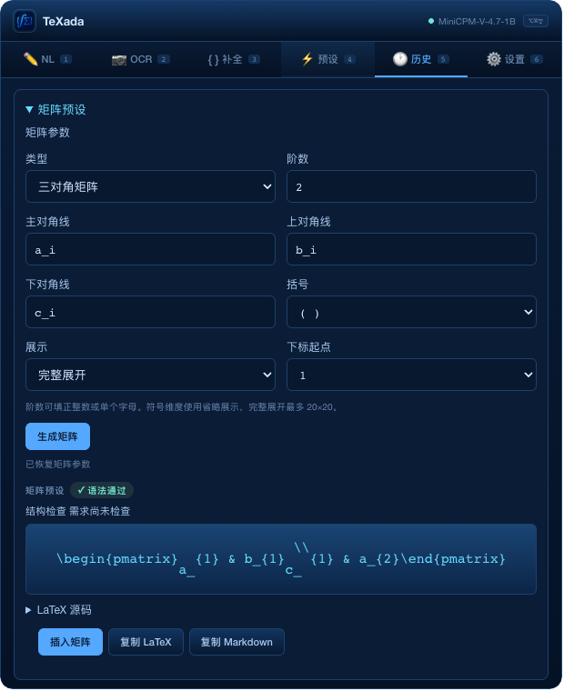
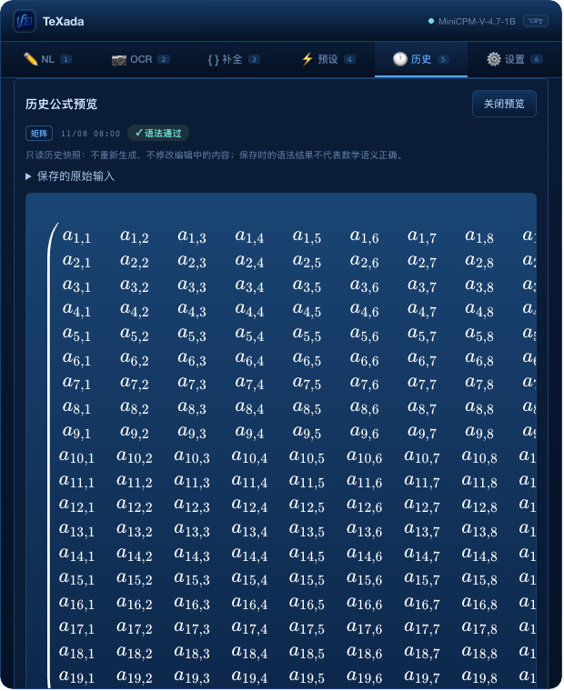

# Issue #70 — history matrix rendering and read-only viewing

## Observed problem / 用户确认

On 2026-11-08 the user paused the next stable release because matrix formulas
opened from History were shown as raw source, and clicking View unexpectedly
navigated to Presets. The pre-fix source is
`0cccb7fa5a3b9efe385803b995cc61a0387bfe6f`; the public installed release remains
v0.4.4. These are two frontend defects, not evidence of failed model inference.

### Rendering failure

The production `renderKatexPreview` passed frozen `KATEX_MACROS` directly to
KaTeX 0.18.2. Matrix/array environments modify the supplied macro namespace.
The actual renderer threw:

```text
TypeError: Cannot add property \cr, object is not extensible
```

Seventy generated matrix expressions reproduced this exception with the
frozen object; the same expressions rendered with a mutable object. The
helper caught the exception and used backend HTML or raw source. Newly
generated results often had backend `katex_html`, hiding the frontend failure;
history records and static preset cards had no HTML fallback.

The earlier KaTeX asset tests used their own mutable options rather than the
production helper, so they did not expose this integration defect. See
[KaTeX macro options](https://katex.org/docs/options) and
[macro persistence and isolation](https://katex.org/docs/api#persistent-macros).

### Unexpected navigation and draft changes

`viewHistoryResult` called `restoreMatrixHistory`, which was designed for
**Reuse input**: it switched tabs, overwrote parameters and invalidated the
current result. View also replaced global render mode and `lastResult`.
A real Chromium baseline test observed `activeTab=tab-shorthand` and zero
`.katex` nodes in the matrix preview.

## Bounded fix

- Keep the shared macro template frozen, but pass a fresh mutable copy to each
  KaTeX call. Temporary and user-defined macros cannot leak across results.
- Inspect saved formulas in an inline, read-only History preview. Do not
  navigate, change editor drafts/parameters, alter global mode/current result,
  generate a new formula or call a model. Old/invalid parameter metadata does
  not prevent reading the saved TeX.
- Preview mathematics even when the record was saved in LaTeX source mode;
  preserve the complete, unchanged source in expandable details.
- Copy LaTeX/Markdown explicitly. Only **Reuse input** restores parameters and
  changes tabs; generating again remains a separate action. Existing stale
  result/commit protections remain in place.
- Report a source-only rendering fallback visibly. Historical syntax status
  is labeled as saved evidence, not a fresh structural or mathematical check.
- Center narrow formulas with auto margins while preserving scrollable left
  and right edges of wide matrices. Closing preview restores focus to View.

## Validation, 2026-11-08

| Scope | Result | Boundary |
| --- | --- | --- |
| New production-helper/history regressions before fix | 1 passed / 16 failed | Preserves the failing baseline |
| New regressions after fix | 17 passed | Calls the vendored KaTeX implementation |
| Complete frontend Node suite | 140 passed | Existing tests plus 17 new cases |
| Focused Python matrix/API/render/frontend tests | 163 passed | No model required |
| Full Python regression | 1722 passed, 14 skipped, 1 deselected | The existing CAS timing failure is disclosed below |
| Real Chromium history workflow | 132/132 matrices; 9 grouped checks; 0 page errors | Actual frontend/KaTeX, isolated mock APIs |
| Native macOS WKWebView | 132/132 matrices; 0 POST; 0 script errors | Actual frontend/KaTeX in a standalone native WebKit harness |

The 132 cases cover seven matrix types; dimensions 1/2/3/10/20 in expanded and
compact display; symbolic dimensions with four brackets and index origins 0/1;
and general/zero rectangular matrices. Geometry checks confirm that the first
column is visible at the left edge and the last column is reachable after
horizontal scrolling. Full source is compared exactly for every history view.

Additional workflow checks cover static preset matrices/cases, generated
matrix previews, draft preservation, exact copying, closing/focus, invalid
saved TeX, legacy `nl` matrix records with unreadable metadata, explicit reuse,
stale-result protection and explicit regeneration. All history viewing and
copying checks produce **zero POST requests**. Only Generate invokes the
mocked matrix API. The browser audit does not contact the user's real backend
or edit their saved history.

The full Python command deselects
`tests/test_cas_transition.py::test_shadow_uses_remaining_request_budget_and_ignores_late_thread_result`.
This timing failure was independently reproduced on unmodified main during
PR #69; no CAS code or assertion was changed to conceal it. GitHub CI is
reported separately on this PR.

[Machine-readable summary](validation/issue70-history-preview-summary.json)

### Screenshots (synthetic audit records)

Before: View navigates to Presets and displays source instead of mathematics.



After: a 20×20 matrix is rendered inside History. Horizontal scrolling exposes
all columns; vertical content remains in the normal page scroll area.



## Reproduction

The required Node regressions use only the repository's existing dependency:

```sh
npm ci
node --test tests/frontend-render-history.test.cjs tests/matrix-presets-ui.test.cjs
node --test tests/*.test.cjs
```

The optional real-browser audit is `eval/check-history-preview.cjs`. It derives
fixtures from the actual Python matrix generator, checks pre-fix code against
the working frontend and uses an isolated browser profile with mocked APIs.
Install `playwright-core` outside the project and select a local Chromium
executable; no application runtime dependency or lockfile change is needed.

```sh
npm install --prefix /tmp/texada-ui-tools --ignore-scripts playwright-core
TEXADA_PLAYWRIGHT_MODULE=/tmp/texada-ui-tools/node_modules/playwright-core \
TEXADA_PYTHON="$PWD/.venv/bin/python" \
TEXADA_BROWSER_EXECUTABLE="/path/to/chromium-or-google-chrome" \
node eval/check-history-preview.cjs
```

`TEXADA_UI_AUDIT_OUTPUT` selects the evidence directory. The recorded pre-fix
commit is the default `TEXADA_UI_BASELINE`; it must be available in the clone.
The optional audit does not use real model inference or user's clipboard data.

## Release boundary

This validates the patched frontend source, **not a newly signed installer**.
The v0.4.4 installation is unchanged. No v0.4.5 tag or stable publication is
created by this work. The installed-package release checks still have to run
before publishing. These rendering tests are not independent mathematical
accuracy, OCR quality or a replacement for the separate #64 insertion evidence.
