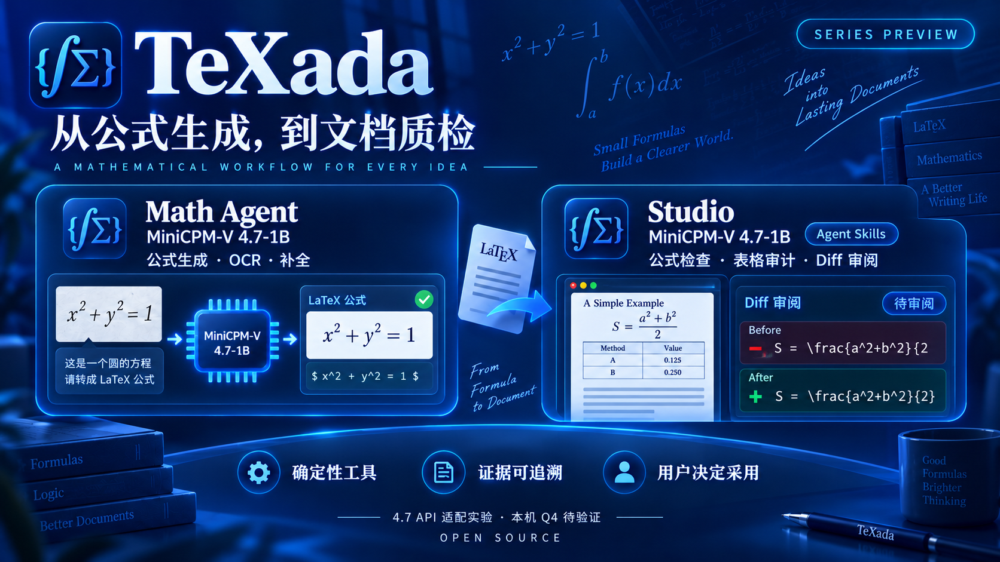

# TeXada 系列

记录日期：2026-10-13。本轮适配与系列材料在本机开发，待审阅后发布。

| 工具 | 任务 | 当前模型链路 | 源码许可证 |
|---|---|---|---|
| [Math Agent](https://github.com/CacinieP/TeXada-the-Math-Agent) | 自然语言转公式、公式图片 OCR、LaTeX 补全；解析、语法检查、确定性修复和渲染 | 4.7 profile 共用一个 MiniCPM-V-4.7-1B checkpoint 承担文本与视觉 | 当前开发版本 AGPL-3.0-or-later；历史标签保留自身许可 |
| [Studio](https://github.com/CacinieP/TeXada-Studio-with-agentskills) | 单个 `.tex` 的行内公式语法、简单表格合计；候选 Diff、人工采用和 Tectonic 预览 | 同一个 MiniCPM-V-4.7-1B 生成公式文本修复候选，检查器回判 | 原创代码、文档与合成样本 AGPL-3.0-only；第三方资源保留自身许可 |

共同流程：生成候选 → 确定性检查 → 展示证据与差异 → 使用者决定是否采用。
两个仓库保留各自的发布和证据；当前系列通过仓库互链和手动案例组成。

## 当前交接

1. 在 Math Agent 输入描述、公式截图或未完成片段。
2. 对照原意或原图审阅候选，复制要采用的 LaTeX。
3. 手动粘贴到 Studio 的单个 `.tex`；目前公式检查按行提取 `$...$`。
4. 查看检查结果和候选 Diff，再决定采用；按需编译、预览、导出。

语法合法和成功渲染不能证明数学含义、OCR 视觉忠实度或计算结论正确。
Studio 的完整项目导入、文档 OCR、多行公式支持及跨应用连接器属于后续范围。
具体输入边界见 [Studio 说明](https://github.com/CacinieP/TeXada-Studio-with-agentskills)。

## 共享模型配置

两项目显式选择 4.7 profile 后均使用 `https://api.modelbest.cn/v1` 和
`MiniCPM-V-4.7-1B`，关闭 thinking。凭证只由进程环境传入。

| 项目 | profile 启动器 | 凭证变量 |
|---|---|---|
| Math Agent | `bash scripts/run-minicpm-v47.sh` | `TEXADA_OPENAI_API_KEY` |
| Studio | `./scripts/run-minicpm-v47-studio.sh` | `VLM_API_KEY`，可复用 `TEXADA_OPENAI_API_KEY`；另需本机访问令牌 `DEMO_TOKEN` |

官方来源：[1B checkpoint](https://huggingface.co/openbmb/MiniCPM-V-4.7-1B)、
[GGUF](https://huggingface.co/openbmb/MiniCPM-V-4.7-1B-gguf)、
[API 文档](https://github.com/OpenBMB/MiniCPM-V/blob/main/docs/api.md)。
本机 Q4 尚未验收，需升级包含 4.7 支持的 llama.cpp 后单独验证；API 结果不能代表量化质量或内存。
Math Agent 配置、数据与限制见 [MiniCPM 4.7](minicpm-v47.md) 和[本次验收](minicpm-v47-evidence.md)。

## 视觉与后续

系列总海报及两仓库封面沿用现有 TeXada logo 的深蓝底、青蓝渐变、圆角图标与白色标题。
图片是工作流示意，不替代真实运行截图。当前公开入口使用中性 TeXada 品牌。

下一步先做同一原创案例的手动交接，记录输入、候选、Diff、检查证据与人工结论，
再按案例需求定义可选连接器。统一报告格式和自动导入当前尚未实现。

## English

TeXada Math Agent handles natural language, formula OCR and completion; TeXada
Studio checks formula syntax and simple table totals in a single `.tex` document
and presents candidate diffs for human adoption. Both tools offer a
MiniCPM-V-4.7-1B profile; the present handoff is copying reviewed LaTeX.
API adaptation and local Q4 acceptance are separate. Each repository retains
its own source license and release process.
