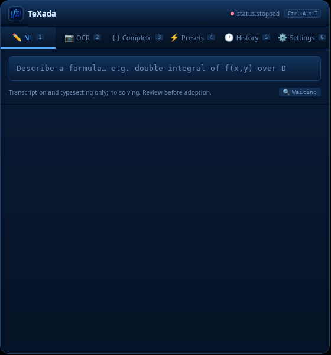

# Ubuntu 24.04 AppImage hardware smoke test

Tested on 2026-11-14 on a separate Ubuntu 24.04.5 LTS x86_64 machine, with an Intel Core i5-7200U (4 logical CPUs), 11 GiB of visible RAM and about 7.1 GiB available before the run. The desktop was launched as a regular user over SSH in an isolated Xvfb session, with fresh TeXada/XDG data directories and `LC_ALL=C.UTF-8`.

- AppImage: `TeXada_0.4.9_amd64.AppImage` from [Linux package CI](https://github.com/CacinieP/TeXada-the-Math-Agent/actions/runs/43576208500), source commit `4709ddd4ed20906d36420de141d28606481f5f16`.
- AppImage SHA-256: `bce835067f9fe2ab026830f60a4be1f412b968f89a20baca3c9e2bfa8e846a2f`.
- The AppImage executable started directly. The first window showed English navigation and the settings API reported `ui_language=en` with no explicit language preference.
- The deterministic smoke query `二重积分` returned valid LaTeX and KaTeX HTML with zero tokens.
- The bundled CPU `llama-server` build 11669 served MiniCPM-V 4.7 1B Q4_K_M using the pinned weights and F16 visual projector. Both model files matched the repository SHA-256 pins. The start request reported ready after 6.414 s.

## Local inference

Requests went to the packaged application's loopback API. Wall time is the curl total for each completed HTTP request. The token count is TeXada's reported total for the run.

| Case | HTTP | Wall time | Tokens | LaTeX result |
| --- | ---: | ---: | ---: | --- |
| Chinese fraction transcription | 200 | 49.763 s | 3,058 | `\frac{x^3 + y^2}{\ln(x+1)}` |
| English infinite series transcription | 200 | 38.413 s | 3,053 | `\sum_{n=2}^{\infty} \frac{\cos(n\theta)}{n^3}` |
| OCR of `x² + y² = z²` | 200 | 77.611 s | 2,918 | `\mathbf{x}^2 + \mathbf{y}^2 = \mathbf{z}^2` |

Both text results matched the requested expression. The OCR result matched the symbols and structure but added bold formatting to the variables. All three returned valid LaTeX, rendered KaTeX HTML and were committed. The OCR response's internal latency field was 34.168 s, while its end-to-end HTTP time was 77.611 s. A process check after the run found no remaining TeXada or llama-server processes for the test account.

[Measured responses and test inputs](results.json) · [Original OCR input](ocr-fixture.png)

The window evidence covers a fresh Xvfb session. Inference requests exercised the packaged loopback service. Interactive desktop launch and clipboard behavior were outside this run.
